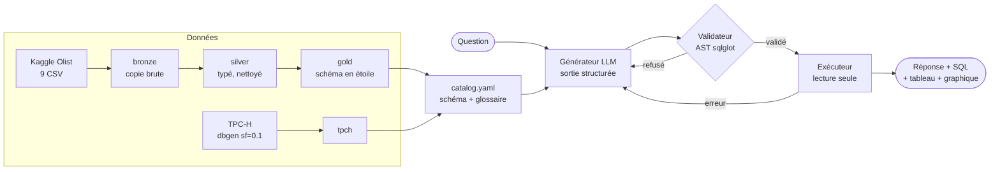

# Agent Text-to-SQL sur Lakehouse

[](https://github.com/wesletieya/text-to-sql-agent/actions/workflows/ci.yml)

Un agent qui répond à des questions en langage naturel (« Quel est le taux de livraisons en retard ? »)
en générant du SQL, **validé puis exécuté en lecture seule** sur un lakehouse DuckDB construit à partir
de données e-commerce réelles (Olist, ~100 000 commandes) et du benchmark TPC-H.

Le projet couvre toute la chaîne : ingestion et modélisation des données, couche sémantique, garde-fous
de sécurité, agent LLM avec auto-correction, banc d'évaluation, API et interface web. Il fonctionne
**entièrement en local et gratuitement** avec un modèle open-weights (Qwen 2.5 Coder 7B via Ollama).


## Points clés

- **81,3 % de bonnes réponses** sur un jeu de 91 questions, avec un modèle local de 7 milliards de
  paramètres, mesurées en comparant les **résultats d'exécution**, jamais le texte SQL.
- **Sécurité en profondeur** : le SQL du LLM est analysé sur son arbre syntaxique (sqlglot) et
  42 attaques sont testées ; la connexion DuckDB ne peut ni écrire, ni lire de fichier, ni charger
  d'extension, même si le validateur laissait passer quelque chose.
- **Un lakehouse pensé pour le LLM** : les pièges du jeu de données (identifiants clients trompeurs,
  doubles comptages, valeurs manquantes) sont corrigés dans le modèle gold et documentés dans un
  glossaire métier, plutôt que laissés au modèle.
- **182 tests** automatisés, lancés par la CI à chaque push.

## Architecture



En cas d'erreur (colonne inventée, SQL invalide), le message d'erreur, et jamais les données, est
renvoyé au LLM, qui a droit à **2 tentatives de correction**.

| Dossier | Contenu |
|---|---|
| [`scripts/`](scripts/) | Téléchargement d'Olist, génération de TPC-H, construction bronze → silver → gold, catalogue |
| [`semantic/`](semantic/) | Catalogue des tables et colonnes, glossaire métier, exemples few-shot |
| [`agent/`](agent/) | Adaptateurs LLM, générateur, validateur, exécuteur, pipeline |
| [`eval/`](eval/) | Jeu d'évaluation, métriques, lancement, rapport, tarifs |
| [`app/`](app/) | API FastAPI et interface Streamlit |
| [`tests/`](tests/) | Tests unitaires, d'attaque et de qualité des données, échantillon Olist commité |

## Les données

### Le modèle gold

| Table | Une ligne = | Colonnes dérivées |
|---|---|---|
| `fact_orders` | une commande | `delivery_days`, `is_late`, `items_count`, `items_value` |
| `fact_order_items` | un article | |
| `fact_payments` | un paiement | |
| `fact_reviews` | un avis (couple avis × commande) | |
| `dim_customer` | **une personne** | ville de sa dernière commande |
| `dim_product` | un produit | `category_en` (traduction, avec repli) |
| `dim_seller`, `dim_date` | un vendeur, un jour | `is_weekend`, trimestre… |

### Les pièges corrigés dans le modèle

L'exploration des données brutes a révélé des pièges qui font produire au LLM des réponses
**fausses mais crédibles**, sans aucune erreur :

| Piège | Conséquence si on l'ignore | Correction |
|---|---|---|
| `customer_id` change à chaque commande | « Clients ayant commandé 2 fois » renvoie **0** | `dim_customer` est clé sur `customer_unique_id` (96 096 personnes) |
| Une commande a plusieurs paiements et plusieurs articles | Les montants sont comptés en double après une jointure | Agrégats précalculés dans `fact_orders`, avertissement dans le catalogue |
| 8 commandes « livrées » sans date de livraison | Délais moyens faussés | `delivery_days` et `is_late` restent `NULL` |
| Les données s'arrêtent le 17/10/2018 | « Clients actifs » avec `CURRENT_DATE` renvoie **0** | Le glossaire impose `max(purchase_date)` |
| « Chiffre d'affaires » a 6 calculs possibles (30 % d'écart) | Chaque réponse semble juste | Une définition unique dans le glossaire |

## Sécurité

Le SQL écrit par un LLM est traité comme une **entrée non fiable**. Deux lignes de défense
indépendantes :

**1. Le validateur** ([`agent/validator.py`](agent/validator.py)) travaille sur l'arbre syntaxique
produit par sqlglot, jamais avec des expressions régulières (qui laisseraient passer
`read_csv('.env')` et bloqueraient une colonne nommée `created_at`). Il impose :

- une seule instruction, de type requête (`SELECT`, CTE, `UNION`) ;
- uniquement les tables du catalogue, qualifiées par leur schéma (les CTE sont gérées, y compris
  une CTE « piégée » qui porte le nom d'une vraie table) ;
- des colonnes qui existent réellement (`qualify` de sqlglot) ;
- aucune fonction d'accès aux fichiers, au réseau ou au système (`read_csv`, `glob`, `getenv`…) ;
- un `LIMIT`, ajouté ou plafonné à 1 000 lignes.

**2. L'exécuteur** ([`agent/executor.py`](agent/executor.py)) ouvre DuckDB en `read_only`, avec
`enable_external_access=false`, le chargement d'extensions désactivé et la configuration verrouillée,
un délai maximal et un plafond de lignes. Ses tests envoient volontairement des attaques **sans passer
par le validateur** : elles échouent toutes.

Enfin, les données lues en base (par exemple les commentaires des avis clients) ne sont jamais
renvoyées au LLM ni ajoutées au prompt, pour éviter les injections de prompt.

## Résultats de l'évaluation

91 questions réparties en 10 catégories (dont 5 hors périmètre et 5 ambiguës), chacune avec une
requête de référence exécutée et vérifiée. Une réponse est juste si **ses résultats** correspondent
à ceux de la référence : l'ordre des colonnes et des lignes est ignoré (sauf si la question l'impose)
et les nombres sont comparés à 2 décimales près.

| Modèle | Précision | SQL valide | Refus corrects | Latence moyenne | Coût |
|---|---|---|---|---|---|
| `qwen2.5-coder:7b` (local, Ollama) | **81,3 %** | 96,3 % | 50,0 % | 19,3 s | 0 $ |

| Catégorie | Score | | Catégorie | Score |
|---|---|---|---|---|
| TPC-H | 100 % | | Glossaire | 90 % |
| Hors périmètre | 100 % | | Classements | 80 % |
| Agrégations | 92 % | | Jointures | 73 % |
| Filtres | 90 % | | Pièges | 60 % |
| Temps | 90 % | | Ambiguës | **0 %** |

Mesure réalisée sur 1 run ; `make eval` en lance 3 pour mesurer la variabilité. Rapport complet :
[`eval/results/report.md`](eval/results/report.md).

### Ce que révèlent les échecs

- **Le modèle ne demande jamais de précision.** Il refuse bien les questions impossibles (5 sur 5),
  mais répond aux questions ambiguës (« les meilleurs vendeurs ? ») en choisissant seul un critère.
- **Les pièges restent difficiles (60 %)** : doubles comptages après jointure, `COUNT(*)` au lieu de
  `COUNT(DISTINCT ...)`, pourcentage calculé sur la mauvaise base.
- **Le glossaire est parfois oublié**, par exemple un chiffre d'affaires qui inclut les commandes annulées.

Aucune requête de référence n'a été modifiée pour améliorer le score : les cas où c'est la question
qui est ambiguë sont signalés, pas corrigés en silence.

## Démarrage

Prérequis : [uv](https://docs.astral.sh/uv/) (qui installe Python 3.11), `make`,
[Ollama](https://ollama.com) et un compte Kaggle (gratuit).

```bash
uv sync                          # dépendances
cp .env.example .env             # puis renseigner la clé Kaggle
ollama pull qwen2.5-coder:7b     # le modèle local (~4,7 Go)
make data                        # construit data/lake.duckdb
make app                         # API sur :8000, interface sur :8501
```

**Important :** le prompt fait environ 6 000 tokens, alors qu'Ollama charge les modèles avec une
fenêtre de 4 096 tokens par défaut et **tronque le prompt en silence**. Définir la variable
d'environnement `OLLAMA_CONTEXT_LENGTH=8192`, puis redémarrer Ollama. L'agent détecte la troncature
et l'indique clairement si ce réglage manque.

Autres modèles possibles : `groq/<modèle>` (`GROQ_API_KEY`), `gemini/<modèle>` (`GEMINI_API_KEY`),
`claude-<modèle>` (`ANTHROPIC_API_KEY`).

| Commande | Rôle |
|---|---|
| `make ask Q="How many orders were delivered late?"` | Pose une question en ligne de commande |
| `make app` | Lance l'API (http://localhost:8000/docs) et l'interface (http://localhost:8501) |
| `docker compose up --build` | Même chose dans des conteneurs (Ollama reste sur la machine hôte) |
| `make data` | Télécharge Olist, génère TPC-H, construit bronze → silver → gold |
| `make catalog` | Régénère le catalogue sans perdre les descriptions écrites à la main |
| `make eval MODEL=<nom>` | Évalue un modèle sur les 91 questions (3 runs) |
| `make report` | Résume tous les résultats d'évaluation |
| `make test` / `make lint` | Tests et style (ruff) |

## Limites

- **Les questions doivent être posées en anglais**, la langue du catalogue et des exemples.
- **Latence de 10 à 50 s** par question avec un modèle 7B sur un GPU portable de 6 Go.
- **Le schéma entier est envoyé à chaque question** (~6 000 tokens). Au-delà de quelques dizaines
  de tables, il faudrait ne sélectionner que les tables pertinentes.
- **Une seule requête à la fois** dans l'API : la connexion DuckDB est partagée.
- La réponse textuelle est un résumé simple (une valeur ou un nombre de lignes), sans second appel au LLM.
- Une comparaison de plusieurs modèles et des ablations (sans glossaire, sans exemples) n'ont pas
  été réalisées ; le banc d'évaluation le permet (`make eval MODEL=...`, puis `make report`).

## Données et licences

- **Code** : licence MIT.
- **Olist** : [Brazilian E-Commerce Public Dataset by Olist](https://www.kaggle.com/datasets/olistbr/brazilian-ecommerce),
  licence CC BY-NC-SA 4.0. Les données ne sont pas redistribuées : `make data` les télécharge.
  Seul un échantillon de 53 commandes est inclus dans `tests/fixtures/` pour les tests.
- **TPC-H** : données synthétiques générées localement par l'extension `tpch` de DuckDB.
